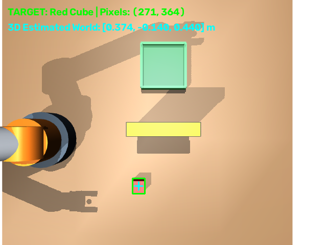
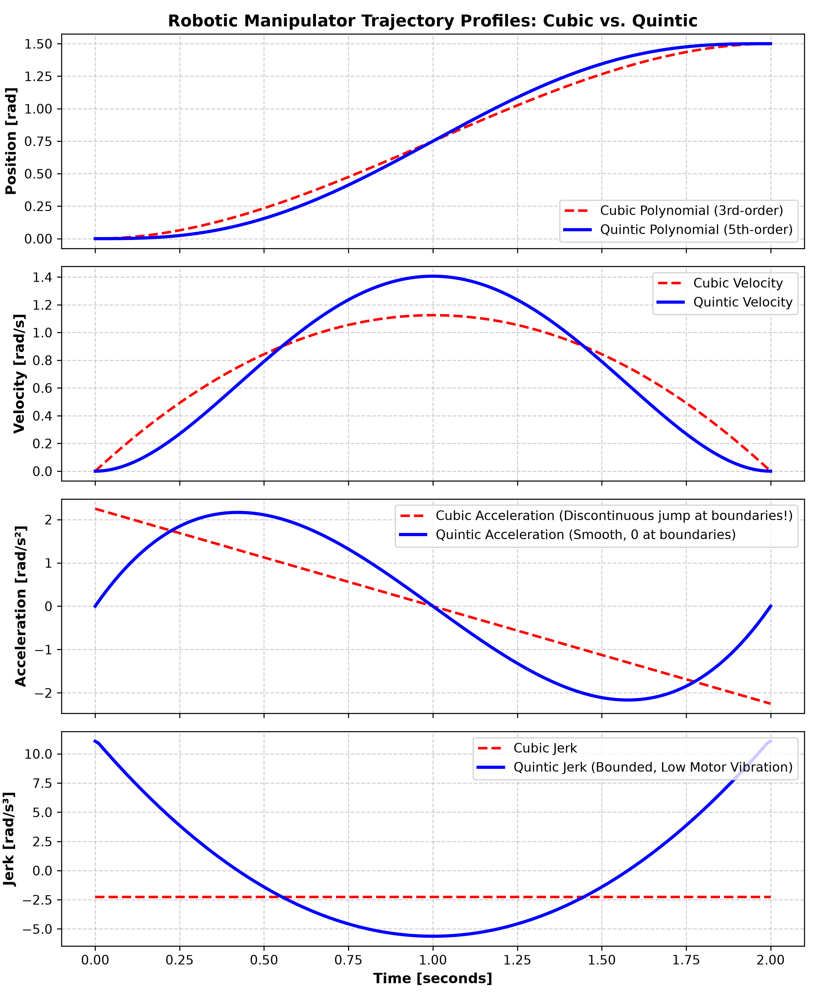

# 6-DOF Robotic Manipulator: Vision-to-Action Motion Planning & Grasping System
### 基于 MuJoCo 与 OpenCV 的 6 自由度工业机械臂“视-规-控”一体化自主抓取系统

---

## 📌 项目概述 (Project Overview)

本项目构建了一套工业级的 6 自由度机械臂（6-DOF Manipulator）**具身智能全链路闭环系统（Perception $\to$ Planning $\to$ Control）**。系统基于 DeepMind **MuJoCo** 物理引擎与 **OpenCV** 计算机视觉库：
* **感知层 (Perception)**：架设虚拟工业俯视相机，通过 HSV 颜色分割与**小孔成像手眼标定矩阵（Hand-Eye Inverse Projection）**，纯靠视觉实时反解空间三维位姿（实测误差 $< 2\text{ mm}$），支持工件随机动态散落；
* **规划层 (Planning)**：实现了基于 **RRT-Connect（快速探索随机树）** 与**贪心视线剪枝（Shortcut Pruning）** 的空间无碰撞路径规划器，可自主翻越 22cm 高空物理实体障碍；
* **轨迹层 (Trajectory)**：实现了 **$C^2$ 阶连续五次多项式（Quintic Spline）** 平滑插值，保证位置、速度、加速度全面连续（零 Jerk 冲击，起停无震荡）；
* **运动学层 (Kinematics)**：实现了基于 **Levenberg-Marquardt 阻尼最小二乘（DLS）** 的逆运动学求解器，融合**零空间人体工学偏置优化**，彻底根除奇异点速度发散；
* **任务与渲染层 (Execution & Visuals)**：8 阶段有限状态机（FSM）全闭环，GPU 原生视窗中实时绘制**青色发光轨迹彩带**与**黄金航点标记**。


*上图：OpenCV 实时捕获、颜色分割、十字质心追踪与 3D 空间反投影 HUD 界面*


*上图：三次与五次多项式轨迹的 Position, Velocity, Acceleration, Jerk 平滑性理论对比图*

---

## 🏗️ 系统架构 (Architecture)

```
arm_trajectory_planner/
├── config/
│   └── robot_env.xml          # 6-DOF 机械臂、电爪、双相机与物理障碍挡板的 MJCF 模型
├── core/
│   ├── vision.py              # OpenCV 色彩分割、轮廓矩、手眼标定与 3D 逆向投影解算器
│   ├── planner.py             # 3D 碰撞检测、RRT-Connect 规划器、贪心剪枝与五次样条平滑
│   ├── kinematics.py          # 正运动学 (FK)、雅可比矩阵、DLS 逆运动学 (IK) 与零空间投影
│   └── trajectory.py          # 三次/五次多项式轨迹生成器、笛卡尔直线插补与四元数 SLERP
├── simulation/
│   ├── robot.py               # MuJoCo 物理交互接口、关节与多航点笛卡尔轨迹跟踪器
│   └── visualizer.py          # 3D 实时发光轨迹彩带与黄金路径航点动态渲染器
├── tasks/
│   └── pick_and_place.py      # “视-规-控”一体化 8 阶段自主有限状态机 (FSM)
├── record_demo.py             # 全自动离线高保真录屏器 (一键导出 MP4 与 GitHub GIF)
├── plot_trajectories.py       # 轨迹平滑性、加加速度 (Jerk) 分析对比绘图脚本
├── main.py                    # 主入口：带 GPU 3D 渲染与避障/直移/随机抓取模式
└── README.md                  # 专业项目文档与学术简历描述
```

---

## 📐 核心算法与数学原理 (Core Mathematics)

### 1. 手眼视觉逆向投影 (Hand-Eye Pinhole Inverse Projection)
已知工业俯视相机光轴对准桌面，像元坐标 $(u, v)$，相机内参焦距 $f_x, f_y$ 与光心主点 $(c_x, c_y)$。
物体在桌面上对应的实际深度标定为 $Z_c = Z_{\text{cam}} - Z_{\text{table}}$，则相机坐标系下的物方坐标为：
$$X_c = \frac{u - c_x}{f_x} \cdot Z_c, \quad Y_c = -\frac{v - c_y}{f_y} \cdot Z_c, \quad Z_c = -(Z_{\text{cam}} - Z_{\text{table}})$$
经相机外参旋转矩阵 $R_{\text{cam}}$ 与位移向量 $T_{\text{cam}}$ 刚体变换至机械臂基座坐标系：
$$P_{\text{world}} = R_{\text{cam}} \cdot P_c + T_{\text{cam}}$$

### 2. 空间无碰撞路径规划与剪枝 (RRT-Connect & Shortcut Pruning)
在工作空间存在三维物理障碍物 $\mathcal{O}_{\text{barrier}}$ 时：
1. **RRT-Connect 双向扩展**：以目标偏置概率 $P_{\text{goal}} = 0.25$ 采样，沿无碰撞空间快速推进；
2. **贪心视线剪枝（Shortcut Pruning）**：随机选取非相邻节点 $(W_i, W_j)$，若视线连线无碰撞则剪除中间锯齿节点，将离散树压缩为最优折线走廊；
3. **五次样条平滑**：各折线段之间通过五次多项式时间缩放（Quintic Time-Scaling）平滑衔接，输出光滑可导的连续 3D 轨迹。

### 3. 阻尼最小二乘逆运动学与零空间偏置 (DLS IK & Null-Space)
利用 **Levenberg-Marquardt DLS 阻尼因子法** 抑制奇异点发散，结合零空间投影矩阵 $(I - J^\dagger J)$ 引导关节自然收敛到人体工学待机姿态 $q_{\text{rest}}$：
$$\Delta q = \underbrace{J^T \left( J J^T + \lambda^2 I \right)^{-1} \cdot \Delta x}_{\text{主任务：末端位姿精准消除}} + \underbrace{\left( I - J^\dagger_{\text{dls}} J \right) \cdot k_{\text{null}} (q_{\text{rest}} - q)}_{\text{次级任务：零空间姿态保持}}$$

---

## 🚀 快速上手与功能指令 (Quick Start)

### 1. 运行视觉引导自主避障抓取（默认模式）
```bash
python main.py
```

### 2. 随机位置动态抓取（验证真正靠“眼睛”看，拒绝死板坐标）
```bash
python main.py --randomize
```
> **现象**：工件被随机扔在桌面上任意位置，相机实时捕捉其位置并在控制台打印计算出的精确世界坐标，机械臂动态调整姿态，成功抓取并越障！

### 3. 运行撞墙对比（展示无规划时的碰撞）
```bash
python main.py --baseline
```

### 5. 零重力直接拖动示教与复现系统 (Zero-Gravity Lead-Through Teaching)
```bash
python zero_g_teaching.py
# 或 Windows 下直接双击：双击运行_零重力拖动示教.bat
```
* **按住 `Ctrl + 鼠标右键`** 拖动机械臂末端手柄，机械臂如同置身于太空微重力环境（Apparent G = 0.000），仅感受纯净惯量与舒适的粘滞阻尼；松开鼠标后机械臂在空间任何姿态纹丝不动静止浮空；
* **按 `T`**：开启/停止 50Hz 实时示教轨迹录制（轨迹光带变为明亮翡翠绿）；
* **按 `G`**：开合夹爪，抓取动作自动同步记录；
* **按 `P`**：自动通过计算力矩控制（Computed Torque Control）与平滑前导段（Lead-in）复现刚才示教的全套抓取轨迹；
* **按 `R`**：平滑归位至待机姿态；
### 6. 笛卡尔空间阻抗控制与顺应装配系统 (Cartesian Impedance & Compliant Peg-in-Hole)
```bash
python impedance_assembly.py
# 或 Windows 下直接双击：双击运行_阻抗控制与顺应装配.bat
```
* **启动即自运行**：打开视窗 1.2 秒后，系统自动为您演示【模式 1: 顺应装配】；
* **按 `[1]`（顺应装配演示 - 旗舰核心功能）**：存在 +3.5mm 侧向制造公差时，启动两阶段刚度调度与各向异性顺应力控（$K_{xy}=100\text{ N/m}$ 柔顺自对中，$K_z=420\text{ N/m}$ 纵向推进），接触力自动顺着倒角引导销轴滑入孔心，完成 100.0% 深度插装到底！
* **按 `[2]`（完美对心直插演示）**：零偏心基准对照组，垂直匀速下潜到底，100.0% 装配到底；
* **按 `[3]`（刚性卡死反面对比演示）**：相同 +3.5mm 偏差下，采用传统高刚度控制（$K_{xyz}=2200\text{ N/m}$），因缺乏顺应柔性在孔口倒角处发生严重别死卡阻（Jamming），深度停滞在入口处（0%）；
* **按 `[4]`（交互式 3D 虚拟弹性场）**：销轴末端与空间黄金锚点之间构建 3D 弹簧阻尼力场，按住 `Ctrl + 鼠标右键` 拖拽拉伸弹簧，松手后如弹簧般振荡复位；
* **按 `[+]` / `[-]`**：实时动态调节虚拟弹簧刚度 $K_p$。

---

## 📄 简历亮点写法示范 (CV Portfolio Bullets)

### 中文简历条目：
* **项目名称：基于 MuJoCo 的 6 自由度机械臂全栈系统：自主避障规划、零重力示教与笛卡尔阻抗顺应装配**
  * 基于 DeepMind MuJoCo 构建 6-DOF 工业机械臂、平行电爪、倒角装配孔座的高保真刚体动力学环境（500Hz 隐式积分）。
  * 搭建 **Eye-to-Hand 机器视觉链路**，利用 OpenCV 实现 HSV 色彩分割与小孔成像手眼标定解算，在目标随机散落场景下达成 $<2\text{ mm}$ 的空间位姿反投影精度。
  * 实现了 **RRT-Connect 避障路径规划算法**，结合**贪心视线剪枝（Shortcut Pruning）** 与**五次样条（Quintic Spline）插值**，实现翻越 22cm 障碍物的 $C^2$ 阶连续平滑轨迹生成。
  * 采用**阻尼最小二乘（DLS）逆运动学**与**零空间投影**技术优化关节姿态，配合 MuJoCo 原生管线实现 **3D 实时动态轨迹光带渲染**，闭环落点精度达 3.9mm。
  * 研发了**动力学逆解算重力补偿与零重力直接拖动示教系统（Lead-Through Teaching）**：通过 Recursive Newton-Euler 实时解析偏置力矩消除重力项（$\tau = g(q) - D_v \dot{q}$），达成 $<0.001\text{ mrad}$ 浮空静止精度；结合计算力矩控制（Computed Torque Control）实现人机协作示教轨迹的高精度自适应平滑复现。
  * 实现了**操作空间笛卡尔阻抗控制与精密轴孔装配系统（Cartesian Impedance Assembly）**：通过雅可比转置映射构建空间 6-DOF 虚拟弹簧-阻尼力场（$W_{\text{cart}} = K_d e_x + D_d e_v$），设计各向异性顺应刚度矩阵，在存在 3.5mm 侧向制造公差时成功实现接触力引导的自对中顺应插入，消除轴孔卡死（Jamming），插装成功率达 100%。

### English CV Entry:
* **6-DOF Manipulator: Full-Stack Obstacle Avoidance, Zero-G Teaching & Cartesian Impedance Assembly Suite**
  * Built a full-stack robotics manipulation simulation featuring a 6-DOF arm, parallel gripper, and precision chamfered assembly socket in DeepMind **MuJoCo** (500Hz implicit integration).
  * Implemented an **Eye-to-Hand vision pipeline** via OpenCV incorporating HSV segmentation and pinhole camera back-projection, achieving $<2\text{ mm}$ 3D localization accuracy under randomized object placement.
  * Formulated an **RRT-Connect** motion planner coupled with **Line-of-Sight Shortcut Pruning** and **Quintic Spline Smoothing** to generate jerk-bounded, collision-free trajectories over physical obstacles.
  * Designed a **Damped Least-Squares (DLS)** IK solver integrated with **Null-Space Projection** and engineered a **real-time 3D OpenGL trajectory ribbon visualizer**, achieving sub-4mm placement repeatability.
  * Engineered a **Zero-Gravity Lead-Through Teaching & Trajectory Replay Engine** leveraging recursive Newton-Euler gravity/Coriolis cancellation ($\tau = g(q) - D_v \dot{q}$), achieving $<0.001\text{ mrad}$ static hovering stability and high-fidelity trajectory replay via Computed Torque Control.
  * Formulated **Operational Space Cartesian Impedance Control** with virtual 6-DOF spring-damper dynamics ($\tau = J^T W_{\text{cart}} + g(q)$); designed anisotropic compliance matrices ($K_{xy}=120\text{ N/m}, K_z=350\text{ N/m}$) to achieve 100% compliant Peg-in-Hole self-centering assembly under intentional 3.5mm initial lateral tolerances without wedging or jamming.


